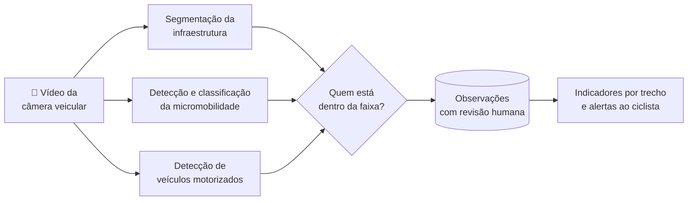

  

  
  
  
  

<table align="center">
  <tr>
    <td align="center" width="220"></td>
    <td>
      <b>Projeto acadêmico</b> da disciplina <b>Projeto Aplicado</b> 
      Pós-graduação em <b>Inteligência Artificial Aplicada</b> — UniSENAI 
      Professor: <b>Willian Daniel de Mattos</b> · Coordenação: <b>Guilherme Bernieri</b>
    </td>
  </tr>
</table>

---

## O problema

São Paulo tem cerca de **760 km de ciclovias e ciclofaixas** e uma frota de bicicletas elétricas, patinetes e ciclomotores que cresce ano a ano. Ao mesmo tempo, as mortes de ciclistas voltaram a subir, e os registros oficiais **não distinguem** bicicleta comum, bicicleta elétrica, autopropelido e ciclomotor.

Falta uma informação básica para quem planeja a cidade e para quem pedala: **quem está, de fato, ocupando a infraestrutura cicloviária — e com que veículos motorizados ela convive?**

## A proposta

O **Lince** transforma vídeos comuns de câmera veicular — gravados no dia a dia, sem finalidade de pesquisa — em **informação estruturada sobre o uso das ciclovias e ciclofaixas**.

| | O que o Lince entrega |
|---|---|
| 🗺️ **Onde** | delimita automaticamente a ciclovia e a ciclofaixa em cada quadro |
| 🚲 **Quem** | identifica e classifica os usuários da via: pessoa, entregador com bag, bicicleta, autopropelido, ciclomotor e motocicleta |
| 🚗 **Com quem convive** | mede a presença de carros junto à faixa e sobre ela |
| 🔔 **Para quê** | alimenta indicadores por trecho e alertas ao ciclista, sempre com revisão humana |

As categorias seguem a **Resolução Contran nº 996/2023**. O Lince **não é um instrumento de fiscalização**: uma detecção na faixa é um registro de ocupação do espaço, não a prova de uma infração.

---

## Como funciona

Três módulos de visão computacional, treinados separadamente, são combinados num único fluxo. A micromobilidade usa uma **arquitetura em cascata** — um detector encontra os objetos e um classificador especializado decide o tipo —, desenhada para a distinção mais difícil do problema: **ciclomotor × bicicleta elétrica × motocicleta**.

---

## Resultados

Avaliados em vídeos reais de avenidas de São Paulo, com partição por vídeo (nenhum vídeo usado no treino aparece na avaliação).

| Módulo | Resultado |
|---|---|
| Segmentação de ciclovia e ciclofaixa | **mAP@0,5 de 0,92** nas máscaras; 94% das ciclofaixas reconhecidas com o tipo correto |
| Detecção de veículos motorizados | **mAP@0,5 de 0,72**; 86% dos carros detectados |
| Micromobilidade (cascata) | três gerações de detectores comparadas; melhor sistema com **macro F1 de 0,50** em seis classes |

**Principal aprendizado:** quando o objeto é encontrado, a maior parte é classificada corretamente — o desafio está em **encontrar** usuários pequenos, distantes e noturnos, e em separar o ciclomotor da bicicleta elétrica.

---

## Status e próximos passos

- ✅ Protótipo dos três módulos e pipeline integrado
- ✅ Backend com revisão humana das observações e interface de consulta
- 🔜 Georreferenciamento automático dos vídeos
- 🔜 Alertas ao ciclista: pessoas na via, entregador à frente, excesso de veículos
- 🔜 Integração com câmeras fixas de trânsito

> O código-fonte, os dados e os modelos treinados **não são públicos**. Este repositório apresenta o projeto.

---

## Autoria

**Ana Carolina Dutra Ramos** e **Miriam de Oliveira de Aguiar Sobral**

| | |
|---|---|
| Instituição | UniSENAI |
| Curso | Pós-graduação em Inteligência Artificial Aplicada |
| Disciplina | Projeto Aplicado |
| Professor | Willian Daniel de Mattos |
| Coordenação | Guilherme Bernieri |

O tema da mobilidade urbana foi apresentado às autoras pela arquiteta **Márcia Lamas** (Lalomar), especialista em mobilidade urbana e acessibilidade.

**Interesse em parcerias, pilotos ou uso do Lince?** Entre em contato pelo perfil [@eumoas](https://github.com/eumoas).

  

---

© 2026 Ana Carolina Dutra Ramos e Miriam de Oliveira de Aguiar Sobral. Todos os direitos reservados. O nome e a marca Lince, os textos e as imagens deste repositório não podem ser reproduzidos ou usados comercialmente sem autorização por escrito das autoras. Veja [LICENSE](LICENSE).
